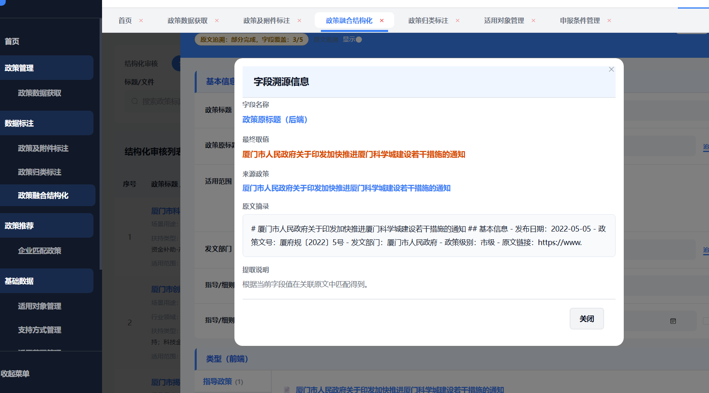
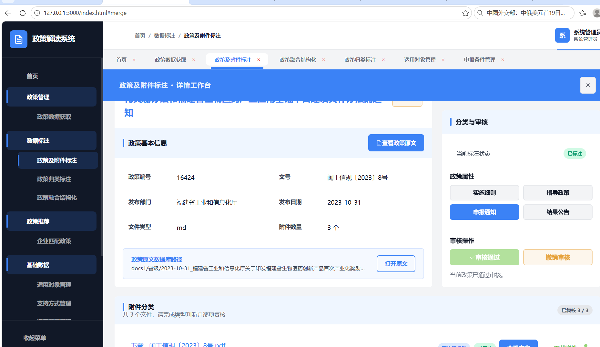

# 政策解读智能管理系统

面向政策管理与企业申报场景的 Web 系统。工作人员对政策正文和附件进行标注，把同一申报事项的多份通知、细则和材料归到一条主政策，再将分散的申报条件整理成结构化结果。审核人员可以从具体字段打开来源文件，核对模型提取或规则匹配的依据。

## 原版界面

### 字段溯源

打开一条主政策的融合详情，点击字段旁的「追溯」，查看最终取值、来源政策、原文摘录和提取说明。字段有来源时可继续打开原文核对。



### 政策及附件标注

标注工作台在同一页面展示政策基本信息、原文、附件分类和审核状态。正文属性包括指导政策、实施细则、申报通知和结果公告，附件使用独立的分类口径。



## 个人贡献

- **前端界面设计与维护**。根据业务需求设计并迭代 Vue 3 + Element Plus 页面，开发政策列表筛选和分页、正文及附件查看等交互，持续维护原版业务页面。
- **接口联调与数据入库**。联调 Vue 前端、Node.js 网关与 Java JDBC 服务，验证数据从达梦查询到页面展示的链路。参与政策和附件数据的批量入库、重复记录预检及入库前后对账，核查记录数、字段和关联关系。
- **融合字段溯源**。实现结构化审核页面的字段追溯交互及相关逻辑。从关联政策和附件匹配原文证据，展示字段最终取值、来源、摘录与覆盖情况，支持打开对应文件复核。
- **政策与附件自动标注 Skill**。以人工标注样本为基准归纳类别规则。正文按类别分层划分训练、验证和测试样本，用训练样本建立分类参考，用验证、测试样本核对效果并分析错分。附件分类结合附件标题、所属政策和正文证据。将评估作为批量标注的前置环节，为未标注数据输出机器标签、证据、置信度和人工复核标记。

## 字段溯源怎么实现

1. 前端在打开融合详情时，收集主政策 ID、关联文档和当前字段值，提交给 Node.js 的 `POST /api/fusion-trace/resolve`。
2. Node.js 按主政策、字段编码和当前字段值核对缓存。缓存无法复用时，从关联政策正文和附件查找证据，申报条件支持按条目匹配。字段值变更后按当前值查找证据，减少误用旧摘录的情况。
3. 接口返回来源、摘录和覆盖情况。页面按来源类型打开政策原文、关联文档或附件，未命中的字段会体现在覆盖统计里。Java JDBC 负责读写达梦中的 `FUSION_TRACE_CACHE`。

| 想看什么 | 代码入口 |
| --- | --- |
| 政策及附件标注工作台 | [pages/merge.html](pages/merge.html) |
| 主政策归类和关联文件 | [pages/policy-classification.html](pages/policy-classification.html) |
| 结构化详情、字段追溯交互 | [pages/structure.html](pages/structure.html) |
| 网关接口、原文读取和证据匹配 | [server.js](server.js) |
| 达梦数据访问、业务查询和追溯缓存 | [JDBCService.java](JDBCService.java) |
| 融合、采集及企业匹配服务 | [backend/](backend/) |

## 本地运行

> GitHub 已提供原版源码和政策附件。完整达梦数据库恢复包尚未发布。可以直接查看截图和源码，也可以独立编译 Java。在空电脑上登录并使用完整业务功能，需要先恢复业务库、字典和可用的网站账号。

### 准备数据库和政策文件

1. 安装 JDK、Node.js 和达梦 DM8。在 Windows 上启动达梦并恢复业务库。本发布版 Java 默认连接 `127.0.0.1:5236`，数据库用户和模式均为 `SYSDBA`。
2. 从 [政策原文和附件 Release](https://github.com/qwan20661-ui/policy-website/releases/tag/original-v1) 下载全部 `policy-files-*.zip`，解压到同一个项目根目录，保留 `docs1/`、`importantplus/`、`target/docs1/` 和 `exports/` 等路径。可用 `SHA256SUMS.txt` 校验分包。
3. 核对库表中的文件路径可以定位到解压后的原文和附件。数据库连接密码和网站登录账号分别配置。

### 在 Windows 上启动

在项目根目录打开 PowerShell。确保 `javac` 和 `node` 可用，或将 `KEJIJU_JAVA_HOME` 设为本机 JDK 根目录。

```powershell
$dbCredential = [pscredential]::new('SYSDBA', (Read-Host '本机达梦 SYSDBA 密码' -AsSecureString))
$env:KEJIJU_DB_PASSWORD = $dbCredential.GetNetworkCredential().Password
try {
    .\start.bat
} finally {
    Remove-Item Env:KEJIJU_DB_PASSWORD -ErrorAction SilentlyContinue
    Remove-Variable dbCredential -ErrorAction SilentlyContinue
}
```

启动脚本会编译 Java，并启动本机 Java JDBC（8080）和 Node（3000）。打开 [本机网站](http://127.0.0.1:3000)，使用恢复后的业务库提供的网站账号登录。可先访问 [健康检查接口](http://127.0.0.1:3000/api/health)，再查看政策列表、融合详情和附件。

只验证编译时，在项目根目录执行下面的命令。它保留 `target/docs1/` 中的政策文件。

```powershell
javac -encoding UTF-8 -d target -cp 'lib/jdbc/DmJdbcDriver8.jar;lib/tika-app-2.9.2.jar' JDBCService.java
```

已有 Java 服务时，可单独运行 `node server.js`，用 `KEJIJU_NODE_PORT` 和 `KEJIJU_JDBC_URL` 配置网关端口及上游。实时 LLM 融合、企业信息接口和远程同步需要各自的服务地址和凭据。远程同步与定时增量采集默认关闭。
