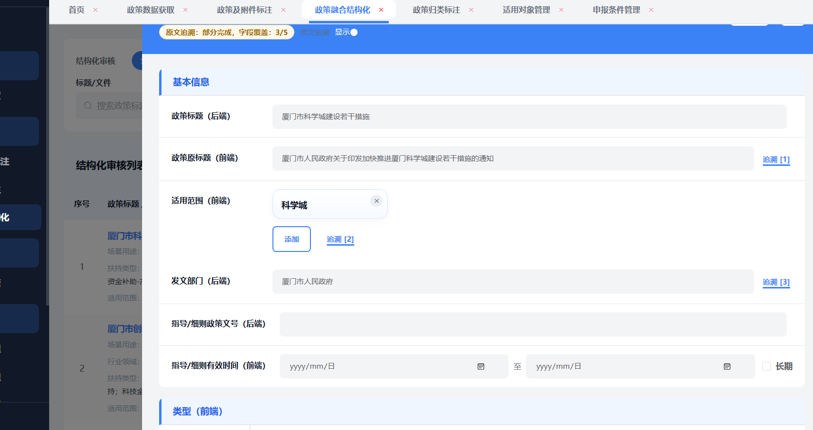

# 政策解读智能管理系统

面向政策管理人员和企业的政策解读系统。管理人员对政策原文和附件进行标注，将同一申报事项的多份通知、实施细则和指导政策归到一条主政策，整理成结构化申报信息。查看融合结果时，可以从字段回到对应的政策原文，核对申请条件的出处。

| 流程 | 可以查看的实现 |
|---|---|
| 政策获取和标注 | 政策列表、原文与附件、分类标签、标注审核 |
| 主政策归类 | 多份政策文件与主政策的关联、上下级关系、归类审核 |
| 融合结构化 | 原版结构化审核列表、详情抽屉、字段编辑和保存 |
| 字段溯源 | 从结构化字段定位关联文件和原文依据 |

前端使用 Vue 和 Element Plus。Node 提供网页入口和接口转发。Java JDBC 负责达梦数据查询与写入。Python 服务承担相关的融合、采集或匹配任务。这里保留原版模块、页面和路由。

## 原版界面



## 代码和政策资料

- 先阅读 [本地运行说明](#启动指南)，了解 Java、Node 和达梦的启动方式。
- 前端入口在 [pages](pages)，Node 网关在 [server.js](server.js)，Java 数据服务在 [JDBCService.java](JDBCService.java)，Python 服务在 [backend](backend)。
- 全量政策正文和附件在 [仓库 Releases](../../releases)。下载同一版本下的全部 policy-files ZIP，并全部解压到仓库根目录。每个 ZIP 自带原有相对路径，保留 docs1、importantplus、target/docs1 和 exports 等目录层级。
- 启动完整业务流程还需可分享的达梦数据库实例及配置。数据库连接密码从本机环境变量读取。企业信息、模型和远端服务依赖各自的运行配置。

## 原项目说明


# 政策解读智能管理系统

企业级政策解读与智能管理平台。前端基于 Vue 3 + Element Plus + ECharts，后端采用 Node.js API 网关 + Java JDBC 中间层架构，连接达梦数据库。

---

## 系统架构

```
┌─────────────────────────────────────────────────────────────────────┐
│  浏览器 (用户访问)                                                   │
│  http://localhost:3000                                              │
└─────────────────────┬───────────────────────────────────────────────┘
                      │ HTTP
                      ▼
┌─────────────────────────────────────────────────────────────────────┐
│  Node.js API 网关  (server.js)         端口 3000                    │
│  ─ 提供前端页面静态服务                                               │
│  ─ 转发 API 请求到 Java JDBC 中间层                                   │
│  ─ CORS 跨域处理                                                    │
└─────────────────────┬───────────────────────────────────────────────┘
                      │ HTTP
                      ▼
┌─────────────────────────────────────────────────────────────────────┐
│  Java JDBC 中间层  (JDBCService.java)    端口 8080                  │
│  ─ 直接连接达梦数据库                                                │
│  ─ 提供 RESTful API 接口                                            │
│  ─ 分页查询 / 统计 / 更新操作                                        │
└─────────────────────┬───────────────────────────────────────────────┘
                      │ JDBC (dm.jdbc.driver.DmDriver)
                      ▼
┌─────────────────────────────────────────────────────────────────────┐
│  达梦数据库 (Dameng DM8)                                            │
│  主机: 127.0.0.1:5236                                          │
│  用户: SYSDBA                                                       │
│  模式: SYSDBA (用户即模式)                                           │
└─────────────────────────────────────────────────────────────────────┘
```

## 环境要求

| 组件 | 版本要求 |
|------|----------|
| **Java** | JDK 8+（推荐 11） |
| **Node.js** | 18+（推荐 20） |
| **达梦数据库** | DM8（运行在 127.0.0.1:5236） |

## 项目结构

```
kejiju-frontend/
├── index.html                  # 首页 / Dashboard
├── server.js                   # Node.js API 网关
├── JDBCService.java            # Java JDBC 中间层服务
├── pom.xml                     # Maven 构建配置
├── compile.bat                 # 编译脚本
├── start.bat                   # 启动脚本
│
├── lib/
│   └── jdbc/
│       ├── DmJdbcDriver8.jar   # 达梦 JDBC 驱动 (JDK 8+，推荐)
│       ├── DmJdbcDriver6.jar   # 达梦 JDBC 驱动 (Java 6)
│       ├── DmJdbcDriver7.jar   # 达梦 JDBC 驱动 (Java 7)
│       └── dialect/            # Hibernate/MyBatis 方言包
│
├── css/
│   ├── common.css              # 公共样式
│   ├── dashboard.css           # Dashboard 样式
│   ├── policy.css              # 政策模块样式
│   └── form.css                # 表单样式
│
├── js/
│   ├── app.js                  # 主应用逻辑
│   ├── menu.js                 # 菜单配置与导航
│   └── mock.js                 # 前端模拟数据
│
├── pages/
│   ├── dashboard.html          # 首页（数据概览）
│   ├── crawler.html            # 政策数据获取
│   ├── merge.html              # 政策及附件标注
│   ├── structure.html          # 政策结构化标注
│   ├── match.html              # 政策匹配企业
│   ├── statistics.html         # 数据统计
│   └── setting.html            # 系统设置
│
├── policy_data.json            # 数据库导出的原始政策数据
├── attachment_data.json        # 数据库导出的附件数据
├── combined_data.js            # 合并后的完整政策数据
├── export_policy.sql           # 数据导出 SQL
└── query.sql                   # 查询示例 SQL
```

## 数据库表结构

### POLICY_ORIGINAL（政策原文表）

| 字段 | 类型 | 说明 |
|------|------|------|
| ID | VARCHAR(36) | 主键 UUID |
| POLICY_TITLE | VARCHAR | 政策标题 |
| URL | CLOB | 原文链接 |
| POLICY_DOCUMENT_NO | VARCHAR | 文号 |
| PUBLISH_DATE | VARCHAR | 发布日期 |
| FILE_TYPE | VARCHAR | 文件类型 |
| ISSUING_DEPARTMENT | VARCHAR | 发布部门 |
| FILE_PATH | VARCHAR | 文件路径 |
| CREATED_AT | TIMESTAMP | 创建时间 |

### ATTACHMENT（附件表）

| 字段 | 类型 | 说明 |
|------|------|------|
| ID | VARCHAR(36) | 主键 UUID |
| POLICY_ORIGINAL_ID | VARCHAR | 关联政策 ID |
| ATTACHMENT_NAME | VARCHAR | 附件名称 |
| FILE_PATH | VARCHAR | 附件路径 |
| CREATED_AT | TIMESTAMP | 创建时间 |

> **注意**：`TYPE`、`ATTACHMENT_TYPE`、`STATUS` 列在数据库当前版本中不存在。如需支持标注功能持久化，需执行：
> ```sql
> ALTER TABLE SYSDBA.POLICY_ORIGINAL ADD TYPE VARCHAR(50);
> ALTER TABLE SYSDBA.POLICY_ORIGINAL ADD ATTACHMENT_TYPE VARCHAR(50);
> ALTER TABLE SYSDBA.POLICY_ORIGINAL ADD STATUS VARCHAR(20) DEFAULT '未标注';
> ```

## 启动指南

> **首次安装先准备数据库。** 本仓库提供原版源码、JDBC 驱动和若干建表或迁移脚本。完整达梦恢复包目前尚未发布。只下载仓库并运行下面的命令，可以编译 Java，但无法在空库里正常登录或查询原版政策。

### 第 1 步：准备达梦、原文与附件

1. 在自己的电脑上安装并启动达梦 DM8。本发布版的 Java 默认连接 `127.0.0.1:5236`，使用 `SYSDBA` 用户和模式。
2. 将可分享的项目恢复包恢复到这个实例。恢复包需要包含业务表结构、政策及关联数据、字典和可使用的演示网站账号。仓库里的零散 SQL 用于特定表或迁移，无法作为完整的空库初始化脚本。
3. 从仓库 Releases 下载政策和附件分包（发布后可下载），全部解压到项目根目录，保留 `docs1/`、`importantplus/` 等路径。确认库表中的文件路径可以定位到解压后的文件。

### 第 2 步：编译并启动服务（Windows）

安装 JDK 和 Node.js，并从仓库根目录打开 PowerShell。`javac` 应在 PATH 中，也可以设置 `KEJIJU_JAVA_HOME` 指向本机 JDK 根目录。以下命令提示输入本机达梦 `SYSDBA` 密码，然后编译并启动 Java（8080）和 Node（3000）。

```powershell
$dbCredential = [pscredential]::new('SYSDBA', (Read-Host '本机达梦 SYSDBA 密码' -AsSecureString))
$env:KEJIJU_DB_PASSWORD = $dbCredential.GetNetworkCredential().Password
try {
    .\start.bat
} finally {
    Remove-Item Env:KEJIJU_DB_PASSWORD -ErrorAction SilentlyContinue
    Remove-Variable dbCredential -ErrorAction SilentlyContinue
}
```

`start.bat` 会使用 JDBC 驱动和 Apache Tika 编译 `JDBCService.java`。如只需验证源码能编译，也可以运行下面这条命令。编译无需数据库或密码，并保留 `target/docs1` 中的文件。

```powershell
javac -encoding UTF-8 -d target -cp 'lib/jdbc/DmJdbcDriver8.jar;lib/tika-app-2.9.2.jar' JDBCService.java
```

### 第 3 步：打开原版网页

访问 [本机网站](http://127.0.0.1:3000)，使用恢复包提供的网站账号登录。到 [健康检查](http://127.0.0.1:3000/api/health) 确认 Java 能连到达梦，再验证原版政策列表、融合详情和附件。网页账号由项目数据库提供，连接达梦的密码在第 2 步输入。

## 本地发布副本配置

- 已有 Java 8080 服务时，可在项目根目录运行 `node server.js`。`KEJIJU_NODE_PORT` 可以修改 Node 端口，`KEJIJU_JDBC_URL` 可以指定 Java 服务地址。
- 运行 LLM 融合或企业信息接口时，还需给对应服务配置地址和凭据，如 `METADATA_API_URL`、`METADATA_API_KEY`、`ENTERPRISE_SERVICE_URL`。
- 远程同步和定时增量采集默认关闭。需要接入时，在运行环境中配置目标服务及凭据。

## API 接口

所有接口由 Java JDBC 中间层提供，Node.js 网关透传。

| 方法 | 路径 | 说明 | 参数 |
|------|------|------|------|
| GET | `/api/policies` | 获取政策列表（分页） | `page`, `size`, `keyword`, `type`, `status` |
| GET | `/api/statistics` | 获取统计数据 | 无 |
| GET | `/api/filterStats` | 获取筛选统计 | 无 |
| POST | `/api/policies/update` | 更新政策分类 | `id`, `type`, `attachmentType` |
| GET | `/api/health` | 健康检查 | 无 |

### 示例

```bash
# 健康检查
curl http://localhost:3000/api/health

# 获取政策列表（第 1 页，每页 5 条）
curl "http://localhost:3000/api/policies?page=1&size=5"

# 搜索政策
curl "http://localhost:3000/api/policies?keyword=翔安区&page=1&size=10"

# 获取统计数据
curl http://localhost:3000/api/statistics
```

### 接口响应格式

```json
{
  "success": true,
  "data": [
    {
      "id": 1,
      "uuid": "2243108c-...",
      "title": "政策标题",
      "documentNo": "文号",
      "publishDate": "2026-05-12",
      "department": "发布部门",
      "fileType": "Markdown",
      "type": "",
      "attachmentType": "",
      "status": "未标注",
      "attachmentCount": 2
    }
  ],
  "pagination": {
    "page": 1,
    "size": 5,
    "total": 119,
    "pages": 24
  }
}
```

## 常见问题

### Q: 编译 JDBCService.java 失败

**原因**：缺少达梦 JDBC 驱动或 Java 版本不符。

**解决**：
```bash
# 确保 JDK 8+ 已安装
java -version

# 确保驱动 JAR 存在
dir lib\jdbc\DmJdbcDriver8.jar

# 编译时指定正确的 classpath
javac -encoding UTF-8 -d target -cp "lib/jdbc/DmJdbcDriver8.jar" JDBCService.java
```

### Q: 连接数据库失败

**原因**：达梦数据库服务不可达或配置错误。

**解决**：
1. 检查网络连通性：`ping 127.0.0.1`
2. 检查端口：`telnet 127.0.0.1 5236`
3. 确认达梦数据库服务正在运行

### Q: 端口 8080 被占用

```bash
# 查找占用端口的进程
netstat -ano | findstr :8080

# 强制终止
taskkill /F /PID <进程ID>
```

### Q: Node.js 服务启动失败

**解决**：
1. 确保端口 3000 未被占用
2. 确保 JDBC 服务已启动（端口 8080）
3. 检查 Node.js 版本：`node -v`（需要 18+）

## 开发说明

### 前端开发说明

- 前端使用 **Vue 3** + **Element Plus** 组件库，依赖文件放在 `lib/cdn/` 目录下本地加载
- 图表使用 **ECharts 5**
- 所有页面放在 `pages/` 目录，通过侧边栏导航切换
- 当前前端使用 `js/mock.js` 中的模拟数据展示，真实数据库连接仅在后端 API 层实现

### 后端开发说明

- JDBC 中间层使用 JDK 内置 `com.sun.net.httpserver`，无需额外 Web 框架
- JSON 序列化为手写实现，生产环境可替换为 Jackson/Gson
- Node.js 网关使用原生 `http` 模块，无 Express 依赖
- 达梦数据库连接 URL 格式：`jdbc:dm://host:port`（不含模式名）


----------------------------------------------------------------------------------------------------------
cd /home/nqiv/demo2/kejiju-frontend
----------------------------------------------------------------------------------------------------------

先拉最新代码：git pull


linux启动服务：
cd /home/nqiv/demo2/kejiju-frontend
# 重新编译（加上 tika）
rm -rf target
mkdir target
javac -encoding UTF-8 -d target -cp "lib/jdbc/DmJdbcDriver8.jar:lib/tika-app-2.9.2.jar" JDBCService.java

# 重启所有服务
kill $(pgrep -f "node server") 2>/dev/null
kill $(pgrep -f "JDBCService") 2>/dev/null

# 启动 JDBC（加上 tika）
nohup java -cp "target:lib/jdbc/DmJdbcDriver8.jar:lib/tika-app-2.9.2.jar" com.policy.jdbcservice.JDBCService > jdbc.log 2>&1 &

# 启动 Node.js
nohup /usr/local/nodejs/bin/node server.js > server.log 2>&1 &

sleep 3
curl http://localhost:3000/api/health


Linux 上的检查命令：
1. 查看进程是否存在

# 查看 Java JDBC 服务进程
ps aux | grep JDBCService

# 查看 Node.js 网关进程
ps aux | grep "node server"
如果进程在，会输出类似：

root 12345 ... java -cp "target:lib/jdbc/DmJdbcDriver8.jar" com.policy.jdbcservice.JDBCService
root 23456 ... node server.js
2. 查看端口监听

# 查看 8080 端口（JDBC 服务）
ss -tlnp | grep 8080
# 或
netstat -tlnp | grep 8080

# 查看 3000 端口（Node.js 网关）
ss -tlnp | grep 3000
# 或
netstat -tlnp | grep 3000

## 🔍 诊断指南 — 端口 3000 掉线排查

当 3000 端口没有输出时，按以下步骤排查：

### 1. 看进程是否还在
```bash
ps aux | grep "node server.js"
```

### 2. 读日志文件
```bash
# 查看详细日志（包含启动、请求、错误、看门狗重启记录等）
tail -200 server.log

# 查看启动日志（包含 start.bat 捕获的 stdout/stderr）
tail -50 server-console.log

# 实时跟踪日志
tail -f server.log
```

### 3. 看日志里的关键信号
当服务停止时，`server.log` 里会记录：
- `[进程退出]` — 进程退出时的 exit code（0=正常退出，非0=异常）
- `[看门狗] 检测到服务停止!` — 看门狗尝试自动重启的记录
- `[慢请求]` — 超过 3 秒未响应的请求（可能是导致卡死的线索）
- `[未捕获异常]` — 代码抛出的未处理异常
- `[未处理拒绝]` — Promise 未捕获的 reject
- `[心跳] 运行 XX 分` — 每 5 分钟一次的服务状态快照

### 4. 尝试重启
```bash
# 先杀掉旧进程
pkill -f "node server.js" 2>/dev/null || kill $(lsof -ti:3000)
# 重新启动
nohup node server.js > server.log 2>&1 &
```

### 5. 已知可能导致进程退出的原因
- JDBC 服务（端口 8080）先挂了，Node 请求大量超时积累导致内存耗尽
- `fs.readdirSync` / `fs.readFileSync` 读取损坏的文件抛出异常
- 系统 OOM killer 强制杀掉 Node 进程（检查 `dmesg | grep oom`）
- 达梦数据库连接池耗尽导致 JDBC 阻塞，Node 请求排队超时


git checkout -- .sessions.json

cd /home/nqiv/demo2/kejiju-frontend || exit 1

echo '=== 1. 重新编译 JDBCService ==='
rm -rf target
mkdir -p target
javac -encoding UTF-8 -d target -cp "lib/jdbc/DmJdbcDriver8.jar:lib/tika-app-2.9.2.jar" JDBCService.java || exit 1

echo '=== 2. 停掉旧服务 ==='
NODE_PID=$(sudo lsof -t -iTCP:3000 -sTCP:LISTEN 2>/dev/null)
JAVA_PID=$(sudo lsof -t -iTCP:8080 -sTCP:LISTEN 2>/dev/null)

[ -n "$NODE_PID" ] && sudo kill "$NODE_PID"
[ -n "$JAVA_PID" ] && sudo kill "$JAVA_PID"

sleep 3

echo '=== 3. 确认端口已经释放 ==='
for i in 1 2 3 4 5; do
  if ! sudo lsof -t -iTCP:3000 -sTCP:LISTEN >/dev/null 2>&1 && \
     ! sudo lsof -t -iTCP:8080 -sTCP:LISTEN >/dev/null 2>&1; then
    break
  fi
  sleep 1
done

echo '=== 4. 启动 JDBC ==='
nohup java -cp "target:lib/jdbc/DmJdbcDriver8.jar:lib/tika-app-2.9.2.jar" \
  com.policy.jdbcservice.JDBCService > jdbc.log 2>&1 &

sleep 3

echo '=== 5. 启动 Node ==='
nohup /usr/local/nodejs/bin/node server.js > server.log 2>&1 &

sleep 3

echo '=== 6. 查看监听端口 ==='
ss -lntp | grep -E ':3000|:8080'

echo '=== 7. 验证接口 ==='
echo '-- Node trace 接口 --'
curl -i -X POST http://127.0.0.1:3000/api/fusion-trace/resolve \
  -H 'Content-Type: application/json' \
  -d '{"fusionPolicyId":"1","fields":[]}'

echo
echo '-- Node 行业领域接口 --'
curl -i http://127.0.0.1:3000/api/territory/industry-names

echo
echo '-- JDBC 行业领域接口 --'
curl -i http://127.0.0.1:8080/api/territory/industry-names
