# 达梦数据库结构文档

> **数据库**: 127.0.0.1:5237
> **用户/模式**: SYSDBA
> **更新日期**: 2026-07-23
> **共计**: 34 张表，字段清单以下文各节为准

> **补充说明**:
> 1. 本文档基于 2026-07-23 达梦库实时结构与已执行审计 SQL 同步整理。
> 2. `POLICY_METADATA.REVIEW_STATUS` 与 `POLICY_ATTACHMENT.ATTACH_REVIEW_STATUS` 当前库内仍为中文状态值，默认 `未通过`。
> 3. `X1_FUSION_POLICY.MARK_REVIEW_STATUS` 与 `X1_FUSION_POLICY.STRUCTURE_REVIEW_STATUS` 当前库内均为 `CHAR(1)`，默认 `0`。
> 4. 审计改造后，以下业务表已统一补充 `CREATED_BY` / `UPDATED_BY` 等审计字段，时间字段保留现有列，不重复新增。
> 5. 基础数据相关表在历史文档/导入脚本与当前运行库之间存在少量字段命名差异；联调与接口开发请优先以“当前运行库口径说明”为准。
> 6. 当前运行库已新增 `SYS_TERRITORY_INDUSTRY_22N` 作为标准化行业领域三级分类表；兼容旧页面的 `/api/territory/industry-names` 仍读取 `SYS_TERRITORY_DATA_NEW`，新增 `/api/territory/industry-22n` 读取新表。

## 0. 审计改造同步说明

本次审计追溯改造覆盖的核心表如下：

| 表名 | 新增审计字段 | 说明 |
|---|---|---|
| `POLICY_METADATA` | `CREATED_AT`, `CREATED_BY`, `UPDATED_BY` | 政策属性、审核状态、备注等写回追溯 |
| `POLICY_ATTACHMENT` | `CREATED_BY`, `UPDATED_BY` | 附件类型、附件审核状态追溯 |
| `X1_FUSION_POLICY` | `CREATED_BY`, `UPDATED_BY` | 融合主政策新增、状态更新、审核流转追溯 |
| `X1_POLICY_DOCUMENT` | `CREATED_BY`, `UPDATED_BY` | 关联、移动、更新、删除、类型修改追溯 |
| `X1_POLICY_BASE_INFO` | `CREATED_BY`, `UPDATED_BY` | 融合文档基础信息追溯 |
| `X1_FUSION_POLICY_RELATION` | `CREATED_BY`, `UPDATED_BY` | 主政策父子关系维护追溯 |
| `FUSION_TRACE_CACHE` | `CREATED_BY`, `UPDATED_BY` | trace 缓存新增、更新、确认追溯 |

统一审计日志表为 `OPERATION_AUDIT_LOG`，用于记录一次写库动作的前后快照、操作者和目标表信息。

### 0.1 当前运行库口径说明

以下差异已经在 2026-07-16 的 `JDBCService.java` 联调链路中实际暴露，后续开发请优先按当前运行库口径处理：

| 表名 | 文档/历史脚本常见写法 | 当前运行库口径 | 开发建议 |
|---|---|---|---|
| `POLICY_KEYWORD_LIBRARY` | `KEYWORD_CATEGORY`、`SUB_CATEGORY`、`KEYWORD_TEXT` | `LEVEL1_NAME`、`LEVEL2_NAME`、`LEVEL3_NAME` | `/api/baseDataRecords?type=policy_keyword`、结构化详情关键词回填统一按 `LEVEL*` 三层字段读写 |
| `DIM_RULE_OPTION` | `OPTION_VALUE` 作为最终展示值 | 当前运行库联调不应再依赖 `OPTION_VALUE`，展示值按 `LEVEL1_NAME`/`LEVEL2_NAME`/`LEVEL3_NAME` 拼接 | `scope_level`、`applicant_type`、`support_type` 查询与下拉接口统一走三级名称拼接 |
| `DIM_POLICY_USAGE` | `OPTION_VALUE` | 当前运行库仍保留 `OPTION_VALUE`，但允许为空 | 展示时优先取 `OPTION_VALUE`，为空时回退拼接 `LEVEL1_NAME`/`LEVEL2_NAME`/`LEVEL3_NAME` |
| `SYS_TERRITORY_DATA_NEW` / `SYS_TERRITORY_INDUSTRY_22N` | 历史页面统一读取 `SYS_TERRITORY_DATA_NEW` | 当前运行库已新增标准化三级分类表 `SYS_TERRITORY_INDUSTRY_22N` | 现网兼容接口 `/api/territory/industry-names` 保持不变；新增查询接口 `/api/territory/industry-22n` 供新链路读取标准分类 |

---

## 目录

1. 一、政策原文相关（核心数据）
2. 二、融合政策（X1 系列）
3. 三、申报条件相关
4. 四、条件聚类（细分条件）
5. 五、字典与配置
6. 六、系统表
7. 七、表关系图

---

## 一、政策原文相关（核心数据）

### 1.1 POLICY_ORIGINAL_V2 — 政策原文数据

政策原文数据，记录从政府网站爬取或导入的政策原始信息。

| # | 字段名 | 类型 | 约束 | 中文说明 |
|---|--------|------|------|----------|
| 1 | POLICY_ID | VARCHAR2(36) | PRIMARY KEY | 政策ID（主键） |
| 2 | POLICY_TITLE | VARCHAR2(500) | NOT NULL | 政策标题 |
| 3 | POLICY_URL | VARCHAR2(1000) | NULL | 政策原文URL地址 |
| 4 | POLICY_CODE | VARCHAR2(200) | NULL | 政策文号（如：国发〔2024〕1号） |
| 5 | PUBLISH_DATE | DATE | NULL | 发布日期 |
| 6 | FILE_TYPE | VARCHAR2(50) | NULL | 文件类型（如：pdf, docx, html） |
| 7 | ISSUE_DEPARTMENT | VARCHAR2(200) | NULL | 发布部门/发文机关 |
| 8 | FILE_PATH | VARCHAR2(2000) | NULL | 文件本地存储路径 |
| 9 | CONTENT | CLOB | NULL | 政策原文全文内容 |
| 10 | CREATE_AT | TIMESTAMP | NOT NULL; DEFAULT CURRENT_TIMESTAMP | 创建时间 |
| 11 | UPDATE_AT | TIMESTAMP | DEFAULT CURRENT_TIMESTAMP | 更新时间 |
| 12 | DEL_FLAG | CHAR(1) | DEFAULT '0' | 删除标记（0=正常，1=删除） |

### 1.2 POLICY_ATTACHMENT — 政策的关联附件文件

政策的关联附件文件，如申报材料模板、附件说明等。

| # | 字段名 | 类型 | 约束 | 中文说明 |
|---|--------|------|------|----------|
| 1 | ATTACH_ID | VARCHAR2(36) | PRIMARY KEY | 附件ID（主键） |
| 2 | POLICY_ID | BIGINT | NOT NULL; FK -> POLICY(ID) | 关联政策ID |
| 3 | ATTACH_NAME | VARCHAR2(500) | NOT NULL | 附件原始文件名 |
| 4 | ATTACH_SHOW_NAME | VARCHAR2(500) | NULL | 附件显示名称 |
| 5 | FILE_PATH | VARCHAR2(500) | NOT NULL | 附件文件路径 |
| 6 | FILE_SUFFIX | VARCHAR2(20) | NULL | 文件后缀（如：pdf, docx, zip） |
| 7 | CREATE_AT | TIMESTAMP | NOT NULL; DEFAULT CURRENT_TIMESTAMP | 创建时间 |
| 8 | UPDATE_AT | TIMESTAMP | DEFAULT CURRENT_TIMESTAMP | 更新时间 |
| 9 | DEL_FLAG | CHAR(1) | DEFAULT '0' | 删除标记 |
| 10 | ATTACH_TYPE | VARCHAR2(50) | NULL | 附件类型（实施细则类/指导政策类/申报材料类等） |
| 11 | ATTACH_REVIEW_STATUS | VARCHAR2(50) | DEFAULT '未通过' | 附件复核状态（当前值：未通过/已通过） |
| 12 | CREATED_BY | VARCHAR2(100) | NULL | 创建操作人 |
| 13 | UPDATED_BY | VARCHAR2(100) | NULL | 最后更新操作人 |

### 1.3 POLICY_METADATA — 政策的标注元数据

政策的标注元数据，包括政策属性、审核状态、适用范围等信息。

| # | 字段名 | 类型 | 约束 | 中文说明 |
|---|--------|------|------|----------|
| 1 | ID | BIGINT | PRIMARY KEY | 自增主键ID |
| 2 | POLICY_ID | BIGINT | NOT NULL; UNIQUE; FK -> POLICY(ID) | 关联政策ID |
| 3 | SCENE_USAGE | VARCHAR2(2000) | NULL | 使用场景/政策用途 |
| 4 | POLICY_ATTRIBUTE | VARCHAR2(100) | NULL | 政策属性分类（指导政策/实施细则/通知公告/结果公告） |
| 5 | ISSUING_DEPARTMENT | VARCHAR2(255) | NULL | 发文机关/发布部门 |
| 6 | POLICY_TITLE_MAIN | VARCHAR2(255) | NULL | 政策主标题 |
| 7 | POLICY_ORIGINAL_TITLE | VARCHAR2(255) | NULL | 政策原文标题 |
| 8 | EFFECTIVE_DATE | VARCHAR2(100) | NULL | 生效日期 |
| 9 | APPLICABLE_SCOPE | VARCHAR2(100) | NULL | 适用范围 |
| 10 | INDUSTRY_FIELD | VARCHAR2(100) | NULL | 所属行业领域 |
| 11 | REVIEW_STATUS | VARCHAR2(50) | DEFAULT '未通过' | 审核状态（当前值：未通过/已通过） |
| 12 | CREATED_AT | TIMESTAMP | DEFAULT CURRENT_TIMESTAMP | 创建时间 |
| 13 | UPDATED_AT | TIMESTAMP | DEFAULT CURRENT_TIMESTAMP | 更新时间 |
| 14 | CREATED_BY | VARCHAR2(100) | NULL | 创建操作人 |
| 15 | UPDATED_BY | VARCHAR2(100) | NULL | 最后更新操作人 |
| 16 | REMARK | VARCHAR2(2000) | NULL | 备注/错误记录 |
| 17 | SCENE_USAGE_ID | VARCHAR(2000) | NULL | 政策用途字典关联ID |
| 18 | INDUSTRY_FIELD_ID | VARCHAR(2000) | NULL | 行业领域字典关联ID |
| 19 | EFFECTIVE_START_DATE | VARCHAR(32) | NULL | 生效开始日期 |
| 20 | EFFECTIVE_END_DATE | VARCHAR(32) | NULL | 生效结束日期 |

### 1.4 POLICY_TYPE_V2 — 记录政策与附件类型的关联关系

记录政策与附件类型的关联关系。

| # | 字段名 | 类型 | 约束 | 中文说明 |
|---|--------|------|------|----------|
| 1 | ID | BIGINT | PRIMARY KEY | 自增主键ID |
| 2 | POLICY_ID | BIGINT | NOT NULL; UNIQUE; FK -> POLICY(ID) | 政策ID |
| 3 | ATTACH_TYPE | VARCHAR2(50) | NULL | 附件类型 |
| 4 | ATTACH_NAME | CLOB | NULL | 附件名称 |

### 1.5 POLICY — 政策基础简要表

政策基础简要信息。

| # | 字段名 | 类型 | 约束 | 中文说明 |
|---|--------|------|------|----------|
| 1 | ID | BIGINT | PRIMARY KEY | 自增主键ID |
| 2 | FILE_NAME | VARCHAR2(255) | NULL | 文件名 |
| 3 | ABSTRACT | CLOB | NULL | 政策摘要 |
| 4 | CONTACT_INFO | CLOB | NULL | 联系方式 |
| 5 | APPLICATION_VOLUME | VARCHAR2(100) | NULL | 申报批次/期数 |
| 6 | POLICY_TITLE | VARCHAR2(1000) | NULL | 政策标题 |
| 7 | CREATED_AT | TIMESTAMP | DEFAULT CURRENT_TIMESTAMP | 创建时间 |
| 8 | UPDATED_AT | TIMESTAMP | DEFAULT CURRENT_TIMESTAMP | 更新时间 |

### 1.6 POLICY_KEYWORD — 政策与关键词的关联表

政策与关键词的关联信息。

| # | 字段名 | 类型 | 约束 | 中文说明 |
|---|--------|------|------|----------|
| 1 | ID | BIGINT | PRIMARY KEY | 自增主键ID |
| 2 | POLICY_ID | BIGINT | NOT NULL; FK -> POLICY(ID) | 政策ID |
| 3 | KEYWORD | VARCHAR2(255) | NULL | 关键词 |
| 4 | KEYWORD_ID | VARCHAR(255) | NULL | 关键词字典关联ID |

### 1.7 POLICY_KEYWORD_LIBRARY — 预定义关键词分类库

预定义关键词分类库。

当前运行库口径：本表已按三级结构维护关键词，接口联调时请使用 `LEVEL1_NAME` / `LEVEL2_NAME` / `LEVEL3_NAME`。
历史文档、旧 SQL 或旧代码中出现的 `KEYWORD_CATEGORY` / `SUB_CATEGORY` / `KEYWORD_TEXT` 仅作旧命名参考，不能直接拿来查当前运行库。

| # | 字段名 | 类型 | 约束 | 中文说明 |
|---|--------|------|------|----------|
| 1 | ID | VARCHAR2(36) | PRIMARY KEY | 主键UUID |
| 2 | LEVEL1_NAME | VARCHAR2(100) | NOT NULL | 一级分类（历史命名：`KEYWORD_CATEGORY`） |
| 3 | LEVEL2_NAME | VARCHAR2(100) | NOT NULL | 二级分类（历史命名：`SUB_CATEGORY`） |
| 4 | LEVEL3_NAME | VARCHAR2(255) | NULL | 三级分类/关键词（历史命名：`KEYWORD_TEXT`） |
| 5 | STATUS | NUMBER(3) | NOT NULL; DEFAULT 1 | 状态：1启用，0停用 |
| 6 | CREATED_BY | VARCHAR2(100) | NULL | 创建操作人 |
| 7 | UPDATED_BY | VARCHAR2(100) | NULL | 最后更新操作人 |
| 8 | CREATED_AT | TIMESTAMP | NOT NULL; DEFAULT CURRENT_TIMESTAMP | 创建时间 |
| 9 | UPDATED_AT | TIMESTAMP | NOT NULL; DEFAULT CURRENT_TIMESTAMP | 更新时间 |

## 二、融合政策（X1 系列）

### 2.1 X1_FUSION_POLICY — 融合政策目录结构

融合政策目录结构，将多个相关子政策整合为一个融合政策。

| # | 字段名 | 类型 | 约束 | 中文说明 |
|---|--------|------|------|----------|
| 1 | ID | BIGINT | PRIMARY KEY | 自增主键ID |
| 2 | SOURCE_POLICY_ID | BIGINT | NULL | 可选：映射现有 POLICY.ID |
| 3 | DIRECTORY_TITLE | VARCHAR2(500) | NOT NULL | xxx 目录标题 |
| 4 | DIRECTORY_PATH | VARCHAR2(1000) | NOT NULL | xxx 目录路径 |
| 5 | MAIN_FILE_TITLE | VARCHAR2(500) | NULL | 主文件标题 |
| 6 | MAIN_FILE_PATH | VARCHAR2(1000) | NULL | 主文件路径 |
| 7 | SORT_NO | INT | NOT NULL; DEFAULT 0 | 排序号 |
| 8 | STATUS | VARCHAR2(20) | NOT NULL; DEFAULT 'ACTIVE' | 状态（ACTIVE/INACTIVE） |
| 9 | DEL_FLAG | CHAR(1) | NOT NULL; DEFAULT '0' | 删除标记 |
| 10 | CREATED_BY | VARCHAR2(100) | NULL | 创建操作人 |
| 11 | UPDATED_BY | VARCHAR2(100) | NULL | 最后更新操作人 |
| 12 | CREATED_AT | TIMESTAMP | NOT NULL; DEFAULT CURRENT_TIMESTAMP | 创建时间 |
| 13 | UPDATED_AT | TIMESTAMP | NOT NULL; DEFAULT CURRENT_TIMESTAMP | 更新时间 |
| 14 | MARK_REVIEW_STATUS | CHAR(1) | DEFAULT '0' | 人工标注审核状态（0=待审核，1=已通过） |
| 15 | MARK_REVIEWED_AT | TIMESTAMP | NULL | 人工标注审核时间 |
| 16 | MARK_REVIEWED_BY | VARCHAR2(100) | NULL | 人工标注审核人 |
| 17 | MARK_REVIEW_REMARK | VARCHAR2(2000) | NULL | 人工标注审核备注 |
| 18 | STRUCTURE_REVIEW_STATUS | CHAR(1) | DEFAULT '0' | 结构化审核状态（0=待审核，1=已通过） |
| 19 | STRUCTURE_REVIEWED_AT | TIMESTAMP | NULL | 结构化审核时间 |
| 20 | STRUCTURE_REVIEWED_BY | VARCHAR2(100) | NULL | 结构化审核人 |
| 21 | STRUCTURE_REVIEW_REMARK | VARCHAR2(2000) | NULL | 结构化审核备注 |

### 2.2 X1_POLICY_DOCUMENT — 融合政策下的各个子文档

融合政策下的各个子文档。

| # | 字段名 | 类型 | 约束 | 中文说明 |
|---|--------|------|------|----------|
| 1 | ID | BIGINT | PRIMARY KEY | 自增主键ID |
| 2 | FUSION_POLICY_ID | BIGINT | NOT NULL; FK -> X1_FUSION_POLICY(ID) | 所属融合政策ID |
| 3 | SOURCE_POLICY_ID | BIGINT | NULL | 源政策ID |
| 4 | POLICY_ATTRIBUTE | VARCHAR2(30) | NOT NULL | 文档属性（实施细则/指导政策/通知公告/申报材料类/申报通知/结果公告） |
| 5 | POLICY_TITLE | VARCHAR2(500) | NOT NULL | 文档标题 |
| 6 | FILE_NAME | VARCHAR2(500) | NOT NULL | 文件名 |
| 7 | FILE_PATH | VARCHAR2(1000) | NOT NULL | 文件路径 |
| 8 | FILE_SUFFIX | VARCHAR2(30) | NULL | 文件后缀 |
| 9 | DISPLAY_ORDER | INT | NOT NULL; DEFAULT 0 | 显示排序 |
| 10 | DEL_FLAG | CHAR(1) | NOT NULL; DEFAULT '0' | 删除标记 |
| 11 | CREATED_BY | VARCHAR2(100) | NULL | 创建操作人 |
| 12 | UPDATED_BY | VARCHAR2(100) | NULL | 最后更新操作人 |
| 13 | CREATED_AT | TIMESTAMP | NOT NULL; DEFAULT CURRENT_TIMESTAMP | 创建时间 |
| 14 | UPDATED_AT | TIMESTAMP | NOT NULL; DEFAULT CURRENT_TIMESTAMP | 更新时间 |

### 2.3 X1_POLICY_BASE_INFO — 融合政策子文档的基本表补充

融合政策子文档的基本信息补充。

| # | 字段名 | 类型 | 约束 | 中文说明 |
|---|--------|------|------|----------|
| 1 | ID | BIGINT | PRIMARY KEY | 自增主键ID |
| 2 | POLICY_DOCUMENT_ID | BIGINT | NOT NULL; UNIQUE; FK -> X1_POLICY_DOCUMENT(ID) | 关联文档ID |
| 3 | PUBLISH_DATE | DATE | NULL | 发布日期 |
| 4 | POLICY_DOCUMENT_NO | VARCHAR2(200) | NULL | 文号 |
| 5 | ISSUING_DEPARTMENT | VARCHAR2(500) | NULL | 发文机关 |
| 6 | POLICY_LEVEL | VARCHAR2(100) | NULL | 政策层级（国家级/省级/市级等） |
| 7 | ORIGINAL_URL | VARCHAR2(2000) | NULL | 原文URL |
| 8 | CREATED_BY | VARCHAR2(100) | NULL | 创建操作人 |
| 9 | UPDATED_BY | VARCHAR2(100) | NULL | 最后更新操作人 |
| 10 | CREATED_AT | TIMESTAMP | NOT NULL; DEFAULT CURRENT_TIMESTAMP | 创建时间 |
| 11 | UPDATED_AT | TIMESTAMP | NOT NULL; DEFAULT CURRENT_TIMESTAMP | 更新时间 |

### 2.4 X1_FUSION_POLICY_RELATION — 融合主政策父子关系表

保存融合主政策之间的直接父子关系，用于层级树展示、上下级维护和目录结构回溯。该表支持一个主政策关联多个上级主政策，也支持一个主政策关联多个下级主政策。

| # | 字段名 | 类型 | 约束 | 中文说明 |
|---|--------|------|------|----------|
| 1 | ID | BIGINT | PRIMARY KEY | 主键ID |
| 2 | PARENT_FUSION_POLICY_ID | BIGINT | NOT NULL | 上级主政策ID |
| 3 | CHILD_FUSION_POLICY_ID | BIGINT | NOT NULL | 下级主政策ID |
| 4 | DEL_FLAG | CHAR(1) | DEFAULT '0' | 删除标记（0=正常，1=删除） |
| 5 | CREATED_BY | VARCHAR2(100) | NULL | 创建操作人 |
| 6 | UPDATED_BY | VARCHAR2(100) | NULL | 最后更新操作人 |
| 7 | CREATED_AT | TIMESTAMP | DEFAULT CURRENT_TIMESTAMP | 创建时间 |
| 8 | UPDATED_AT | TIMESTAMP | DEFAULT CURRENT_TIMESTAMP | 更新时间 |

### 2.5 FUSION_TRACE_CACHE — 融合详情字段溯源缓存

缓存融合详情字段的来源证据、技术路径和人工确认结果，用于融合详情 trace 联调与校验。

| # | 字段名 | 类型 | 约束 | 中文说明 |
|---|--------|------|------|----------|
| 1 | ID | VARCHAR2(50) | PRIMARY KEY | 主键ID |
| 2 | FUSION_POLICY_ID | VARCHAR2(50) | NULL | 关联融合政策ID |
| 3 | FIELD_CODE | VARCHAR2(300) | NULL | 字段编码 |
| 4 | FIELD_NAME | VARCHAR2(200) | NULL | 字段名称 |
| 5 | FIELD_PATH | VARCHAR2(500) | NULL | 字段路径 |
| 6 | RECORD_TYPE | VARCHAR2(100) | NULL | 记录类型 |
| 7 | RECORD_ID | VARCHAR2(100) | NULL | 记录ID |
| 8 | FINAL_VALUE | CLOB | NULL | 最终展示值 |
| 9 | VALUE_HASH | VARCHAR2(64) | NULL | 字段值哈希 |
| 10 | SOURCE_POLICY_ID | VARCHAR2(50) | NULL | 来源政策ID |
| 11 | SOURCE_POLICY | VARCHAR2(500) | NULL | 来源政策标题 |
| 12 | SOURCE_POLICY_ATTRIBUTE | VARCHAR2(100) | NULL | 来源政策属性 |
| 13 | SOURCE_TYPE | VARCHAR2(100) | NULL | 来源类型 |
| 14 | SOURCE_FILE_PATH | VARCHAR2(1000) | NULL | 来源文件路径 |
| 15 | TECHNICAL_PATH | VARCHAR2(300) | NULL | 技术定位路径 |
| 16 | EVIDENCE | CLOB | NULL | 证据片段 |
| 17 | DESCRIPTION | CLOB | NULL | 说明描述 |
| 18 | VALIDATION_STATUS | VARCHAR2(50) | NULL | 校验状态 |
| 19 | CONFIRM_STATUS | VARCHAR2(50) | NULL | 人工确认状态 |
| 20 | MATCH_METHOD | VARCHAR2(50) | NULL | 匹配方式 |
| 21 | CONFIDENCE | DECIMAL(10,4) | NULL | 置信度 |
| 22 | CONFIRMED_BY | VARCHAR2(100) | NULL | 确认人 |
| 23 | CONFIRMED_AT | TIMESTAMP | NULL | 确认时间 |
| 24 | DEL_FLAG | VARCHAR2(1) | DEFAULT '0' | 删除标记（0=正常，1=删除） |
| 25 | CREATED_BY | VARCHAR2(100) | NULL | 创建操作人 |
| 26 | UPDATED_BY | VARCHAR2(100) | NULL | 最后更新操作人 |
| 27 | CREATED_AT | TIMESTAMP | DEFAULT CURRENT_TIMESTAMP | 创建时间 |
| 28 | UPDATED_AT | TIMESTAMP | DEFAULT CURRENT_TIMESTAMP | 更新时间 |

## 三、申报条件相关

### 3.1 APPLICATION_CONDITION — 政策申报条件的基本表

政策申报条件的基本信息。

| # | 字段名 | 类型 | 约束 | 中文说明 |
|---|--------|------|------|----------|
| 1 | ID | BIGINT | PRIMARY KEY | 自增主键ID |
| 2 | POLICY_ID | BIGINT | NOT NULL; UNIQUE; FK -> POLICY(ID) | 关联政策ID |
| 3 | APPLICABLE_TARGET | VARCHAR2(255) | NULL | 适用对象/申报主体要求 |
| 4 | APPLICATION_REQUIREMENT | CLOB | NULL | 申报条件要求（详细描述） |
| 5 | APPLICATION_TIME | VARCHAR2(255) | NULL | 申报时间 |
| 6 | ANNOUNCEMENT_DATE | VARCHAR2(255) | NULL | 公示时间/公告日期 |
| 7 | APPLICABLE_TARGET_ID | VARCHAR(2000) | NULL | 适用对象字典关联ID |
| 8 | APPLICATION_START_TIME | VARCHAR(32) | NULL | 申报开始时间 |
| 9 | APPLICATION_END_TIME | VARCHAR(32) | NULL | 申报结束时间 |
| 10 | PROMPT_CONTENT | VARCHAR(1000) | NULL | 提示词内容 |

### 3.2 APPLICATION_CONDITION_DICT — 申报条件模板/字典配置

申报条件模板/字典配置，用于结构化抽取申报条件。

| # | 字段名 | 类型 | 约束 | 中文说明 |
|---|--------|------|------|----------|
| 1 | ID | VARCHAR2(36) | PRIMARY KEY | 主键ID（UUID） |
| 2 | CODE | VARCHAR2(100) | DEFAULT '' | 编码 |
| 3 | APPLY_TYPE | VARCHAR2(100) | NOT NULL | 申报类型（如：高新技术企业认定） |
| 4 | LEVEL1 | VARCHAR2(100) | DEFAULT '' | 一级分类 |
| 5 | LEVEL2 | VARCHAR2(100) | DEFAULT '' | 二级分类 |
| 6 | LEVEL3 | VARCHAR2(100) | DEFAULT '' | 三级分类 |
| 7 | NAME | VARCHAR2(200) | NOT NULL | 条件名称 |
| 8 | KEYWORDS | VARCHAR2(500) | DEFAULT '' | 关键词（逗号分隔） |
| 9 | DESCRIPTION | VARCHAR2(1000) | DEFAULT '' | 条件说明/范围定义 |
| 10 | STATUS | VARCHAR2(20) | DEFAULT '启用' | 状态（启用/禁用） |
| 11 | CREATED_BY | VARCHAR2(100) | NULL | 创建操作人 |
| 12 | UPDATED_BY | VARCHAR2(100) | NULL | 最后更新操作人 |
| 13 | CREATE_TIME | TIMESTAMP | DEFAULT CURRENT_TIMESTAMP | 创建时间 |
| 14 | UPDATE_TIME | TIMESTAMP | DEFAULT CURRENT_TIMESTAMP | 更新时间 |

### 3.3 APPLICATION_ATTACHMENT — 政策在申报环节要求的附加材料

政策在申报环节要求的附加材料。

| # | 字段名 | 类型 | 约束 | 中文说明 |
|---|--------|------|------|----------|
| 1 | ID | BIGINT | PRIMARY KEY | 自增主键ID |
| 2 | POLICY_ID | BIGINT | NOT NULL; FK -> POLICY(ID) | 关联政策ID |
| 3 | ATTACHMENT_NAME | VARCHAR2(255) | NULL | 附件名称 |

### 3.4 APPLICATION_MATERIAL — 申报所需材料、申报方式和网址

申报所需材料、申报方式和网址。

| # | 字段名 | 类型 | 约束 | 中文说明 |
|---|--------|------|------|----------|
| 1 | ID | BIGINT | PRIMARY KEY | 自增主键ID |
| 2 | POLICY_ID | BIGINT | NOT NULL; UNIQUE; FK -> POLICY(ID) | 关联政策ID |
| 3 | APPLICATION_MATERIALS | CLOB | NULL | 申报材料清单 |
| 4 | APPLICATION_METHOD | CLOB | NULL | 申报方式/流程 |
| 5 | APPLICATION_URL | CLOB | NULL | 申报网址 |

### 3.5 SUPPORT_METHOD — 政策的资金扶持、奖励方式和额度

政策的资金扶持、奖励方式和额度。

| # | 字段名 | 类型 | 约束 | 中文说明 |
|---|--------|------|------|----------|
| 1 | ID | BIGINT | PRIMARY KEY | 自增主键ID |
| 2 | POLICY_ID | BIGINT | NOT NULL; UNIQUE; FK -> POLICY(ID) | 关联政策ID |
| 3 | SUPPORT_CONTENT_DESC | CLOB | NULL | 支持内容描述 |
| 4 | SUPPORT_TYPE | VARCHAR2(255) | NULL | 扶持类型（资金奖励/税收优惠/贷款贴息等） |
| 5 | SUPPORT_AMOUNT | CLOB | NULL | 扶持金额/标准 |
| 6 | MAX_SUPPORT_AMOUNT | VARCHAR2(100) | NULL | 最高扶持金额 |
| 7 | SUPPORT_TYPE_ID | VARCHAR(2000) | NULL | 扶持类型字典关联ID |

## 四、条件聚类（细分条件）

条件聚类各表通过 `CONDITION_ID` 关联回 `APPLICATION_CONDITION.ID`，用于对政策的申报条件进行精细化结构化拆解，支撑企业匹配和智能审核。

### 4.1 CONDITION_CLUSTER — 条件聚类主表

条件聚类主表，承载企业工商基础信息等条件。

| # | 字段名 | 类型 | 约束 | 中文说明 |
|---|--------|------|------|----------|
| 1 | ID | BIGINT | PRIMARY KEY | 自增主键ID |
| 2 | CONDITION_ID | BIGINT | NOT NULL; UNIQUE; FK -> APPLICATION_CONDITION(ID) | 关联条件ID |
| 3 | BASIC_UNIT_NAME | VARCHAR2(255) | NULL | 单位名称 |
| 4 | BASIC_CREDIT_CODE | VARCHAR2(50) | NULL | 统一社会信用代码 |
| 5 | BASIC_REGISTER_DATE | VARCHAR2(100) | NULL | 注册日期要求 |
| 6 | BASIC_ENTERPRISE_NATURE | VARCHAR2(100) | NULL | 企业性质 |
| 7 | BASIC_ENTERPRISE_TYPE_VALUE | CLOB | NULL | 企业类型值 |
| 8 | BASIC_ENTERPRISE_TYPE_SOURCE | CLOB | NULL | 企业类型数据来源 |
| 9 | BASIC_LEGAL_REPRESENTATIVE | VARCHAR2(100) | NULL | 法定代表人要求 |
| 10 | BASIC_INSTITUTION_NATURE | VARCHAR2(100) | NULL | 机构性质 |
| 11 | REG_ADDRESS_VALUE | CLOB | NULL | 注册地址值 |
| 12 | REG_ADDRESS_SOURCE | CLOB | NULL | 注册地址数据来源 |
| 13 | REG_REGISTER_DATE | VARCHAR2(100) | NULL | 注册成立日期要求 |
| 14 | REG_ACTUAL_ADDRESS | VARCHAR2(255) | NULL | 实际经营地址 |
| 15 | REG_TERRITORIAL_INFO | VARCHAR2(255) | NULL | 属地信息 |
| 16 | REG_TAX_TERRITORY | VARCHAR2(255) | NULL | 税收属地 |
| 17 | BIZ_SUBJECT_QUALIFICATION | VARCHAR2(255) | NULL | 经营主体资格 |
| 18 | BIZ_UNIT_TYPE | VARCHAR2(255) | NULL | 单位类型 |
| 19 | BIZ_OPERATION_STATUS | VARCHAR2(255) | NULL | 经营状态 |
| 20 | BIZ_SCOPE_VALUE | CLOB | NULL | 经营范围值 |
| 21 | BIZ_SCOPE_SOURCE | CLOB | NULL | 经营范围数据来源 |

### 4.2 CORE_TEAM — 企业核心团队/人才条件要求

企业核心团队/人才条件要求。

| # | 字段名 | 类型 | 约束 | 中文说明 |
|---|--------|------|------|----------|
| 1 | ID | BIGINT | PRIMARY KEY | 自增主键ID |
| 2 | CONDITION_ID | BIGINT | NOT NULL; UNIQUE; FK -> APPLICATION_CONDITION(ID) | 关联条件ID |
| 3 | TALENT_HEALTH_STATUS | VARCHAR2(100) | NULL | 人才健康状况要求 |
| 4 | TALENT_NATIONALITY_REQ | VARCHAR2(100) | NULL | 人才国籍要求 |
| 5 | TALENT_AGE_REQ | VARCHAR2(100) | NULL | 人才年龄要求 |
| 6 | TALENT_LANGUAGE_ABILITY | VARCHAR2(100) | NULL | 人才语言能力要求 |
| 7 | TEAM_EMPLOYEE_COUNT_VALUE | VARCHAR2(100) | NULL | 员工人数值 |
| 8 | TEAM_EMPLOYEE_COUNT_OPERATOR | VARCHAR2(20) | NULL | 员工人数条件运算符（≥/≤/=） |
| 9 | TEAM_EMPLOYEE_COUNT_UNIT | VARCHAR2(50) | NULL | 员工人数单位 |
| 10 | TEAM_EMPLOYEE_COUNT_SOURCE | CLOB | NULL | 员工人数数据来源 |
| 11 | TEAM_SIZE | VARCHAR2(100) | NULL | 团队规模 |
| 12 | TEAM_RD_PERSONNEL_COUNT | VARCHAR2(100) | NULL | 研发人员数量 |
| 13 | TEAM_TECH_PERSONNEL_RATIO | VARCHAR2(100) | NULL | 科技人员占比 |
| 14 | TEAM_TECH_PERSONNEL_COUNT | VARCHAR2(100) | NULL | 技术人员数量 |
| 15 | TEAM_PROJECT_LEADER_ROLE | VARCHAR2(100) | NULL | 项目负责人角色要求 |
| 16 | EDU_PHD_COUNT | VARCHAR2(100) | NULL | 博士人数要求 |
| 17 | EDU_BACHELOR_COUNT | VARCHAR2(100) | NULL | 本科人数要求 |
| 18 | EDU_MASTER_COUNT | VARCHAR2(100) | NULL | 硕士人数要求 |
| 19 | EDU_TECH_AWARD_VALUE | CLOB | NULL | 技术获奖要求值 |
| 20 | EDU_TECH_AWARD_SOURCE | CLOB | NULL | 技术获奖数据来源 |
| 21 | EDU_TITLE_REQ | CLOB | NULL | 职称要求 |
| 22 | EDU_PROJECT_EXPERIENCE | CLOB | NULL | 项目经验要求 |

### 4.3 INNOVATION_DEVELOPMENT — 企业规模与发展能力条件

企业规模与发展能力条件。

| # | 字段名 | 类型 | 约束 | 中文说明 |
|---|--------|------|------|----------|
| 1 | ID | BIGINT | PRIMARY KEY | 自增主键ID |
| 2 | CONDITION_ID | BIGINT | NOT NULL; UNIQUE; FK -> APPLICATION_CONDITION(ID) | 关联条件ID |
| 3 | SCALE_PERSONNEL_VALUE | VARCHAR2(100) | NULL | 人员规模值 |
| 4 | SCALE_PERSONNEL_OPERATOR | VARCHAR2(20) | NULL | 人员规模条件运算符 |
| 5 | SCALE_PERSONNEL_UNIT | VARCHAR2(50) | NULL | 人员规模单位 |
| 6 | SCALE_PERSONNEL_SOURCE | CLOB | NULL | 人员规模数据来源 |
| 7 | SCALE_MARKET_VALUE | VARCHAR2(100) | NULL | 市场规模值 |
| 8 | SCALE_MARKET_OPERATOR | VARCHAR2(20) | NULL | 市场规模条件运算符 |
| 9 | SCALE_MARKET_UNIT | VARCHAR2(50) | NULL | 市场规模单位 |
| 10 | SCALE_MARKET_SOURCE | CLOB | NULL | 市场规模数据来源 |
| 11 | SCALE_TAX_SCALE | VARCHAR2(100) | NULL | 纳税规模 |
| 12 | SCALE_REVENUE_VALUE | VARCHAR2(100) | NULL | 营业收入值 |
| 13 | SCALE_REVENUE_OPERATOR | VARCHAR2(20) | NULL | 营业收入条件运算符 |
| 14 | SCALE_REVENUE_UNIT | VARCHAR2(50) | NULL | 营业收入单位 |
| 15 | SCALE_REVENUE_SOURCE | CLOB | NULL | 营业收入数据来源 |
| 16 | SCALE_ASSET_VALUE | VARCHAR2(100) | NULL | 资产总额值 |
| 17 | SCALE_ASSET_OPERATOR | VARCHAR2(20) | NULL | 资产总额条件运算符 |
| 18 | SCALE_ASSET_UNIT | VARCHAR2(50) | NULL | 资产总额单位 |
| 19 | SCALE_ASSET_SOURCE | CLOB | NULL | 资产总额数据来源 |
| 20 | GROWTH_NET_PROFIT_GROWTH_RATE | VARCHAR2(100) | NULL | 净利润增长率 |
| 21 | GROWTH_NET_ASSET_GROWTH_RATE | VARCHAR2(100) | NULL | 净资产增长率 |
| 22 | GROWTH_RD_GROWTH_RATE | VARCHAR2(100) | NULL | 研发投入增长率 |
| 23 | GROWTH_REVENUE_GROWTH_RATE | VARCHAR2(100) | NULL | 营业收入增长率 |

### 4.4 INNOVATION_INVESTMENT — 企业研发和创新投入条件

企业研发和创新投入条件。

| # | 字段名 | 类型 | 约束 | 中文说明 |
|---|--------|------|------|----------|
| 1 | ID | BIGINT | PRIMARY KEY | 自增主键ID |
| 2 | CONDITION_ID | BIGINT | NOT NULL; UNIQUE; FK -> APPLICATION_CONDITION(ID) | 关联条件ID |
| 3 | INFRA_FACILITY_STATUS | CLOB | NULL | 研发基础设施情况 |
| 4 | MGMT_RD_SYSTEM_VALUE | SMALLINT | NULL | 研发管理制度值 |
| 5 | MGMT_RD_SYSTEM_SOURCE | CLOB | NULL | 研发管理制度数据来源 |
| 6 | EQUIP_RD_EQUIPMENT_ORIGINAL | VARCHAR2(100) | NULL | 研发设备原值要求 |
| 7 | COST_ANNUAL_RD_INVESTMENT | VARCHAR2(100) | NULL | 年研发投入额 |
| 8 | COST_RD_INVESTMENT_INTENSITY | VARCHAR2(100) | NULL | 研发投入强度 |
| 9 | PROJ_IMPLEMENTATION_LOCATION | VARCHAR2(255) | NULL | 项目实施地点 |
| 10 | PROJ_EXECUTION_PERIOD | VARCHAR2(100) | NULL | 项目执行期限 |
| 11 | PROJ_PROJECT_FUNDING | VARCHAR2(100) | NULL | 项目经费 |

### 4.5 INNOVATION_OUTPUT — 企业创新成果产出条件

企业创新成果产出条件。

| # | 字段名 | 类型 | 约束 | 中文说明 |
|---|--------|------|------|----------|
| 1 | ID | BIGINT | PRIMARY KEY | 自增主键ID |
| 2 | CONDITION_ID | BIGINT | NOT NULL; UNIQUE; FK -> APPLICATION_CONDITION(ID) | 关联条件ID |
| 3 | TRADE_ACHIEVEMENT_TYPE | VARCHAR2(255) | NULL | 技术成果类型 |
| 4 | TRADE_TECH_TRADE_AMOUNT | VARCHAR2(100) | NULL | 技术交易额 |
| 5 | TRADE_TECH_ACHIEVEMENT_TRANSFER | CLOB | NULL | 技术成果转化要求 |
| 6 | IP_PATENT | CLOB | NULL | 专利要求 |
| 7 | IP_ACHIEVEMENT | CLOB | NULL | 成果要求 |
| 8 | IP_STANDARD_VALUE | CLOB | NULL | 标准制定要求值 |
| 9 | IP_STANDARD_SOURCE | CLOB | NULL | 标准制定数据来源 |
| 10 | IP_PAPER_LITERATURE | CLOB | NULL | 论文文献要求 |
| 11 | IP_SOFTCOPY_TRADEMARK | CLOB | NULL | 软件著作权/商标要求 |
| 12 | IP_IP_AGREEMENT | CLOB | NULL | 知识产权协议 |

### 4.6 INNOVATION_IMPACT — 企业合规性、信用、融资和资质等综合条件

企业合规性、信用、融资和资质等综合条件。

| # | 字段名 | 类型 | 约束 | 中文说明 |
|---|--------|------|------|----------|
| 1 | ID | BIGINT | PRIMARY KEY | 自增主键ID |
| 2 | CONDITION_ID | BIGINT | NOT NULL; UNIQUE; FK -> APPLICATION_CONDITION(ID) | 关联条件ID |
| 3 | COLLAB_AGREEMENT | CLOB | NULL | 合作协议要求 |
| 4 | COLLAB_FOUNDATION | CLOB | NULL | 合作基础要求 |
| 5 | COLLAB_INTERNATIONAL_FOUNDATION | CLOB | NULL | 国际合作基础 |
| 6 | COLLAB_RESEARCH_INSTITUTE | CLOB | NULL | 科研院所合作要求 |
| 7 | COLLAB_UNIVERSITY | CLOB | NULL | 高校合作要求 |
| 8 | CREDIT_PRODUCT_COMPLIANCE | CLOB | NULL | 产品合规性要求 |
| 9 | CREDIT_ENTERPRISE_CREDIT | CLOB | NULL | 企业信用要求 |
| 10 | CREDIT_ETHICS_COMPLIANCE | CLOB | NULL | 科研伦理合规要求 |
| 11 | CREDIT_SAFETY_MAJOR_ACCIDENT | SMALLINT | NULL | 安全生产重大事故要求 |
| 12 | CREDIT_SAFETY_SOURCE | CLOB | NULL | 安全生产数据来源 |
| 13 | CREDIT_BUSINESS_ABNORMAL_LIST | SMALLINT | NULL | 经营异常名录要求 |
| 14 | CREDIT_BUSINESS_SERIOUS_DISHONESTY_LIST | SMALLINT | NULL | 严重违法失信名单要求 |
| 15 | CREDIT_BUSINESS_SOURCE | CLOB | NULL | 经营信用数据来源 |
| 16 | CREDIT_ANNUAL_REPORT_FORMULA | CLOB | NULL | 年报合规公式 |
| 17 | CREDIT_GOVERNMENT_PERSONNEL_RESTRICTION | CLOB | NULL | 公职人员限制条件 |
| 18 | CREDIT_LEGAL_COMPLIANCE_VALUE | SMALLINT | NULL | 法律合规值 |
| 19 | CREDIT_LEGAL_COMPLIANCE_SOURCE | CLOB | NULL | 法律合规数据来源 |
| 20 | CREDIT_RESEARCH_CREDIT_VALUE | SMALLINT | NULL | 科研信用值 |
| 21 | CREDIT_RESEARCH_CREDIT_SOURCE | CLOB | NULL | 科研信用数据来源 |
| 22 | CREDIT_TAX_CREDIT | CLOB | NULL | 纳税信用要求 |
| 23 | CREDIT_ADMIN_PENALTY_VALUE | SMALLINT | NULL | 行政处罚要求值 |
| 24 | CREDIT_ADMIN_PENALTY_SOURCE | CLOB | NULL | 行政处罚数据来源 |
| 25 | CREDIT_QUALITY_MAJOR_ACCIDENT | SMALLINT | NULL | 质量安全重大事故要求 |
| 26 | CREDIT_QUALITY_SOURCE | CLOB | NULL | 质量安全数据来源 |
| 27 | CREDIT_REPEAT_APPLICATION_RESTRICTION | CLOB | NULL | 重复申报限制 |
| 28 | FIN_INVESTOR | CLOB | NULL | 投资方要求 |
| 29 | FIN_FINANCING_AMOUNT | VARCHAR2(100) | NULL | 融资金额 |
| 30 | FIN_FINANCING_STAGE | VARCHAR2(100) | NULL | 融资阶段 |
| 31 | QUAL_TALENT_QUALIFICATION | CLOB | NULL | 人才资质要求 |
| 32 | QUAL_ENTERPRISE_QUALIFICATION_VALUE | CLOB | NULL | 企业资质要求值 |
| 33 | QUAL_ENTERPRISE_QUALIFICATION_SOURCE | CLOB | NULL | 企业资质数据来源 |
| 34 | QUAL_PLATFORM_QUALIFICATION_VALUE | CLOB | NULL | 平台资质要求值 |
| 35 | QUAL_PLATFORM_QUALIFICATION_SOURCE | CLOB | NULL | 平台资质数据来源 |
| 36 | PROJ_COOP_UNIT_COUNT | VARCHAR2(100) | NULL | 合作单位数量 |
| 37 | PROJ_COOP_UNIT_TYPE | VARCHAR2(100) | NULL | 合作单位类型 |
| 38 | PROJ_JOINT_APPLICATION | CLOB | NULL | 联合申报要求 |

### 4.7 MAIN_PRODUCT — 企业主要产品或服务的条件要求

企业主要产品或服务的条件要求。

| # | 字段名 | 类型 | 约束 | 中文说明 |
|---|--------|------|------|----------|
| 1 | ID | BIGINT | PRIMARY KEY | 自增主键ID |
| 2 | CONDITION_ID | BIGINT | NOT NULL; UNIQUE; FK -> APPLICATION_CONDITION(ID) | 关联条件ID |
| 3 | MAIN_PRODUCT_NAME | VARCHAR2(255) | NULL | 主要产品名称 |
| 4 | MAIN_SERVICE | VARCHAR2(255) | NULL | 主要服务内容 |
| 5 | CORE_PRODUCT | VARCHAR2(255) | NULL | 核心产品 |
| 6 | PRODUCT_STAGE | VARCHAR2(100) | NULL | 产品阶段（研发/试产/量产） |

### 4.8 MAIN_TECHNOLOGY — 企业核心技术领域条件要求

企业核心技术领域条件要求。

| # | 字段名 | 类型 | 约束 | 中文说明 |
|---|--------|------|------|----------|
| 1 | ID | BIGINT | PRIMARY KEY | 自增主键ID |
| 2 | CONDITION_ID | BIGINT | NOT NULL; UNIQUE; FK -> APPLICATION_CONDITION(ID) | 关联条件ID |
| 3 | NATIONAL_STRATEGIC_INDUSTRY_CATEGORY | VARCHAR2(255) | NULL | 国家战略性产业分类 |
| 4 | INDUSTRY_FIELD | VARCHAR2(255) | NULL | 产业领域 |
| 5 | CORE_TECHNOLOGY_FIELD | VARCHAR2(255) | NULL | 核心技术领域 |

## 五、字典与配置

### 5.1 BASE_DATA_DICT — 各类基础数据字典

各类基础数据字典，如政策用途、关键词、适用对象、扶持类型、适用范围等。

| # | 字段名 | 类型 | 约束 | 中文说明 |
|---|--------|------|------|----------|
| 1 | ID | VARCHAR2(36) | PRIMARY KEY | 主键ID（UUID） |
| 2 | TYPE | VARCHAR2(50) | NOT NULL | 数据类型（policy_usage/policy_keyword/applicable_object/support_type/applicable_scope） |
| 3 | LEVEL1 | VARCHAR2(100) | DEFAULT '' | 一级分类 |
| 4 | LEVEL2 | VARCHAR2(100) | DEFAULT '' | 二级分类 |
| 5 | NAME | VARCHAR2(200) | NOT NULL | 名称 |
| 6 | CODE | VARCHAR2(100) | DEFAULT '' | 编码 |
| 7 | DESCRIPTION | VARCHAR2(1000) | DEFAULT '' | 描述/范围定义说明 |
| 8 | STATUS | VARCHAR2(20) | DEFAULT '启用' | 状态（启用/禁用） |
| 9 | CREATED_BY | VARCHAR2(100) | NULL | 创建操作人 |
| 10 | UPDATED_BY | VARCHAR2(100) | NULL | 最后更新操作人 |
| 11 | CREATE_TIME | TIMESTAMP | DEFAULT CURRENT_TIMESTAMP | 创建时间 |
| 12 | UPDATE_TIME | TIMESTAMP | DEFAULT CURRENT_TIMESTAMP | 更新时间 |

### 5.2 CATEGORY_FIELD_INFO — 各级分类的核心字段/属性表

各级分类的核心字段/属性信息。

| # | 字段名 | 类型 | 约束 | 中文说明 |
|---|--------|------|------|----------|
| 1 | ID | VARCHAR(36) | PRIMARY KEY | 主键ID |
| 2 | LEVEL1_CATEGORY | VARCHAR(100) | NOT NULL; DEFAULT '' | 一级类别 |
| 3 | LEVEL2_CATEGORY | VARCHAR(100) | NOT NULL; DEFAULT '' | 二级类别 |
| 4 | LEVEL3_CATEGORY | VARCHAR(200) | NOT NULL | 三级类别 |
| 5 | CORE_FIELDS | CLOB | NULL | 核心字段 |
| 6 | CREATED_BY | VARCHAR2(100) | NULL | 创建操作人 |
| 7 | UPDATED_BY | VARCHAR2(100) | NULL | 最后更新操作人 |
| 8 | CREATED_AT | TIMESTAMP | DEFAULT CURRENT_TIMESTAMP | 创建时间 |
| 9 | UPDATED_AT | TIMESTAMP | DEFAULT CURRENT_TIMESTAMP | 更新时间 |

### 5.3 DIM_POLICY_USAGE — 政策用途二级分类维度

政策用途二级分类维度。

当前运行库口径：`OPTION_VALUE` 仍然可用，但接口联调时不能假设它一定非空；当前页面展示应优先取 `OPTION_VALUE`，为空时回退拼接 `LEVEL1_NAME` / `LEVEL2_NAME` / `LEVEL3_NAME`。

| # | 字段名 | 类型 | 约束 | 中文说明 |
|---|--------|------|------|----------|
| 1 | ID | VARCHAR2(36) | PRIMARY KEY | 主键UUID |
| 2 | LEVEL1_NAME | VARCHAR2(100) | NOT NULL | 一级分类 |
| 3 | LEVEL2_NAME | VARCHAR2(200) | NOT NULL | 二级分类 |
| 4 | DESCRIPTION | TEXT | NULL | 政策用途范围定义说明 |
| 5 | OPTION_VALUE | VARCHAR2(255) | NULL | 兼容展示值，允许为空；为空时按三级名称拼接展示 |
| 6 | OPTION_CODE | VARCHAR2(100) | NULL | 用途编码 |
| 7 | SORT_ORDER | NUMBER(11) | NOT NULL; DEFAULT 0 | 排序 |
| 8 | STATUS | NUMBER(3) | NOT NULL; DEFAULT 1 | 状态：1启用 0停用 |
| 9 | CREATED_BY | VARCHAR2(100) | NULL | 创建操作人 |
| 10 | UPDATED_BY | VARCHAR2(100) | NULL | 最后更新操作人 |
| 11 | CREATED_AT | TIMESTAMP | NOT NULL; DEFAULT CURRENT_TIMESTAMP | 创建时间 |
| 12 | UPDATED_AT | TIMESTAMP | NOT NULL; DEFAULT CURRENT_TIMESTAMP | 更新时间 |
| 13 | LEVEL3_NAME | VARCHAR2(200) | NULL | 三级分类 |

### 5.4 DIM_RULE_OPTION — 各类规则选项值

各类规则选项值，支持多级分类和层级关系。

当前运行库口径：`scope_level`、`applicant_type`、`support_type` 相关接口联调时不要再依赖 `OPTION_VALUE`。
展示值统一按 `LEVEL1_NAME` / `LEVEL2_NAME` / `LEVEL3_NAME` 组合，旧文档或旧脚本里出现的 `OPTION_VALUE` 属于历史口径。

| # | 字段名 | 类型 | 约束 | 中文说明 |
|---|--------|------|------|----------|
| 1 | ID | VARCHAR2(36) | PRIMARY KEY | 主键UUID |
| 2 | RULE_TYPE | VARCHAR2(64) | NOT NULL | 规则类型：policy_type/scope_level/applicant_type/support_type |
| 3 | LEVEL1_NAME | VARCHAR2(100) | NOT NULL | 一级名称 |
| 4 | LEVEL2_NAME | VARCHAR2(100) | NULL | 二级名称 |
| 5 | OPTION_CODE | VARCHAR2(100) | NULL | 规则编码 |
| 6 | PARENT_ID | VARCHAR2(36) | NULL | 父级ID，预留层级扩展 |
| 7 | SORT_ORDER | NUMBER(11) | NOT NULL; DEFAULT 0 | 排序 |
| 8 | STATUS | NUMBER(3) | NOT NULL; DEFAULT 1 | 状态：1启用 0停用 |
| 9 | CREATED_BY | VARCHAR2(100) | NULL | 创建操作人 |
| 10 | UPDATED_BY | VARCHAR2(100) | NULL | 最后更新操作人 |
| 11 | CREATED_AT | TIMESTAMP | NOT NULL; DEFAULT CURRENT_TIMESTAMP | 创建时间 |
| 12 | UPDATED_AT | TIMESTAMP | NOT NULL; DEFAULT CURRENT_TIMESTAMP | 更新时间 |
| 13 | LEVEL3_NAME | VARCHAR2(100) | NULL | 三级名称 |

## 六、系统表

### 6.1 SYS_USER — 系统登录用户表

系统登录用户信息。

| # | 字段名 | 类型 | 约束 | 中文说明 |
|---|--------|------|------|----------|
| 1 | ID | BIGINT | PRIMARY KEY | 自增主键ID（用户ID） |
| 2 | USERNAME | VARCHAR(50) | NOT NULL; UNIQUE | 用户名（登录名） |
| 3 | PASSWORD | VARCHAR(100) | NOT NULL | 密码 |
| 4 | REAL_NAME | VARCHAR(50) | NULL | 真实姓名 |
| 5 | EMAIL | VARCHAR(100) | NULL | 电子邮箱 |
| 6 | PHONE | VARCHAR(20) | NULL | 手机号码 |
| 7 | ROLE | VARCHAR(20) | DEFAULT 'user' | 角色（admin/user） |
| 8 | STATUS | INT | DEFAULT 1 | 状态（1=启用，0=禁用） |
| 9 | LAST_LOGIN_TIME | TIMESTAMP | NULL | 最后登录时间 |
| 10 | CREATE_TIME | TIMESTAMP | DEFAULT SYSDATE | 创建时间 |
| 11 | UPDATE_TIME | TIMESTAMP | DEFAULT SYSDATE | 更新时间 |

### 6.2 SYS_TERRITORY_DATA_NEW — 行业领域分级数据（2026版）

行业领域分级数据，当前兼容接口 `/api/territory/industry-names` 仍从该表提取一级、二级名称，供 `structure` 页面沿用旧口径。

| # | 字段名 | 类型 | 约束 | 中文说明 |
|---|--------|------|------|----------|
| 1 | ID | NUMBER(20) | PRIMARY KEY | 主键ID |
| 2 | TENANT_ID | NUMBER(11) | NOT NULL; DEFAULT 1 | 所属租户 |
| 3 | TYPE | VARCHAR2(255) | NULL | 任务类型id |
| 4 | TYPE_NAME | VARCHAR2(255) | NULL | 任务类型名称 |
| 5 | TASK_ID | NUMBER(20) | NULL | 任务id |
| 6 | TERRITORY_ID | VARCHAR2(255) | NULL | 行业领域一级id |
| 7 | TERRITORY_NAME | VARCHAR2(255) | NULL | 行业领域一级name |
| 8 | TERRITORY_TWO_ID | VARCHAR2(255) | NULL | 行业领域二级id |
| 9 | TERRITORY_TWO_NAME | VARCHAR2(255) | NULL | 行业领域二级name |
| 10 | TERRITORY_THREE_ID | VARCHAR2(255) | NULL | 行业领域三级id |
| 11 | TERRITORY_THREE_NAME | VARCHAR2(255) | NULL | 行业领域三级name |
| 12 | TERRITORY_FOUR_ID | VARCHAR2(255) | NULL | 行业领域四级id |
| 13 | TERRITORY_FOUR_NAME | VARCHAR2(255) | NULL | 行业领域四级name |
| 14 | REMARK | TEXT | NULL | 备注 |
| 15 | CREATE_USER | NUMBER(11) | NULL | 创建人 |
| 16 | CREATE_TIME | TIMESTAMP | DEFAULT CURRENT_TIMESTAMP | 创建时间 |
| 17 | UPDATE_USER | NUMBER(11) | NULL | 更新人 |
| 18 | UPDATE_TIME | TIMESTAMP | DEFAULT CURRENT_TIMESTAMP | 更新时间 |
| 19 | DEL_FLAG | NUMBER(11) | DEFAULT 0 | 删除标识  0：启用，1：作废 |

### 6.3 SYS_TERRITORY_INDUSTRY_22N — 标准化行业领域三级分类表

当前运行库新增的标准化行业领域分级表，供新接口 `/api/territory/industry-22n` 查询。相比 `SYS_TERRITORY_DATA_NEW`，该表去掉了任务/租户等过程字段，直接按一级、二级、三级分类存储。

| # | 字段名 | 类型 | 约束 | 中文说明 |
|---|--------|------|------|----------|
| 1 | ID | BIGINT | PRIMARY KEY | 主键ID |
| 2 | FIRST_CATEGORY | VARCHAR(100) | NOT NULL | 一级分类 |
| 3 | SECOND_CATEGORY | VARCHAR(100) | NULL | 二级分类 |
| 4 | THIRD_CATEGORY | VARCHAR(100) | NULL | 三级分类 |
| 5 | STATUS | NUMBER(3) | NOT NULL; DEFAULT 1 | 状态（1=启用，0=禁用） |
| 6 | CREATE_TIME | TIMESTAMP | NOT NULL; DEFAULT CURRENT_TIMESTAMP | 创建时间 |
| 7 | UPDATE_TIME | TIMESTAMP | NOT NULL; DEFAULT CURRENT_TIMESTAMP | 更新时间 |

### 6.4 ##HISTOGRAMS_TABLE — 达梦系统直方图表

达梦数据库列直方图统计信息表。

| # | 字段名 | 类型 | 约束 | 中文说明 |
|---|--------|------|------|----------|
| 1 | OWNER | VARCHAR(128) | NULL | 表所有者 |
| 2 | TABLE_NAME | VARCHAR(128) | NULL | 表名 |
| 3 | COLUMN_NAME | VARCHAR(128) | NULL | 列名 |
| 4 | HISTOGRAM | VARCHAR(15) | NULL | 直方图类型 |
| 5 | ENDPOINT_VALUE | VARCHAR(128) | NULL | 端点值 |
| 6 | ENDPOINT_HEIGHT | BIGINT | NULL | 端点高度/频率 |
| 7 | ENDPOINT_KEYHEIGHT | BIGINT | NULL | 端点键高度 |
| 8 | ENDPOINT_DISTINCT | BIGINT | NULL | 端点不同值数量 |

### 6.5 OPERATION_AUDIT_LOG — 前端写库统一审计日志表

记录前端用户一次写库动作的统一审计日志，可通过 `TRACE_ID` 串联一次页面操作影响的多张表。

| # | 字段名 | 类型 | 约束 | 中文说明 |
|---|--------|------|------|----------|
| 1 | ID | VARCHAR2(36) | PRIMARY KEY | 主键 UUID |
| 2 | TRACE_ID | VARCHAR2(64) | NULL | 一次前端操作的链路 ID |
| 3 | MODULE | VARCHAR2(100) | NULL | 模块名，如 `base-data` |
| 4 | ACTION | VARCHAR2(50) | NULL | 操作类型，如 create/update/delete/clear |
| 5 | TARGET_TABLE | VARCHAR2(100) | NULL | 目标表名 |
| 6 | TARGET_ID | VARCHAR2(100) | NULL | 目标记录主键 |
| 7 | BIZ_KEY | VARCHAR2(200) | NULL | 业务主键或分类标识 |
| 8 | OPERATOR_ID | VARCHAR2(100) | NULL | 操作人 ID |
| 9 | OPERATOR_NAME | VARCHAR2(100) | NULL | 操作人姓名/用户名 |
| 10 | BEFORE_JSON | CLOB | NULL | 修改前快照 |
| 11 | AFTER_JSON | CLOB | NULL | 修改后快照 |
| 12 | REMARK | VARCHAR2(1000) | NULL | 审计备注 |
| 13 | CREATED_AT | TIMESTAMP | DEFAULT CURRENT_TIMESTAMP | 日志写入时间 |

## 七、表关系图

```mermaid
erDiagram
    POLICY ||--o{ POLICY_ATTACHMENT : POLICY_ID
    POLICY ||--o{ POLICY_METADATA : POLICY_ID
    POLICY ||--o{ POLICY_TYPE_V2 : POLICY_ID
    POLICY ||--o{ POLICY_KEYWORD : POLICY_ID
    POLICY ||--o{ APPLICATION_CONDITION : POLICY_ID
    POLICY ||--o{ APPLICATION_MATERIAL : POLICY_ID
    POLICY ||--o{ APPLICATION_ATTACHMENT : POLICY_ID
    POLICY ||--o{ SUPPORT_METHOD : POLICY_ID
    X1_FUSION_POLICY ||--o{ X1_POLICY_DOCUMENT : FUSION_POLICY_ID
    X1_POLICY_DOCUMENT ||--|| X1_POLICY_BASE_INFO : POLICY_DOCUMENT_ID
    X1_FUSION_POLICY ||--o{ X1_FUSION_POLICY_RELATION : PARENT_FUSION_POLICY_ID
    X1_FUSION_POLICY ||--o{ X1_FUSION_POLICY_RELATION : CHILD_FUSION_POLICY_ID
    X1_FUSION_POLICY ||--o{ FUSION_TRACE_CACHE : FUSION_POLICY_ID
    APPLICATION_CONDITION ||--|| CONDITION_CLUSTER : CONDITION_ID
    APPLICATION_CONDITION ||--|| CORE_TEAM : CONDITION_ID
    APPLICATION_CONDITION ||--|| INNOVATION_DEVELOPMENT : CONDITION_ID
    APPLICATION_CONDITION ||--|| INNOVATION_INVESTMENT : CONDITION_ID
    APPLICATION_CONDITION ||--|| INNOVATION_OUTPUT : CONDITION_ID
    APPLICATION_CONDITION ||--|| INNOVATION_IMPACT : CONDITION_ID
    APPLICATION_CONDITION ||--|| MAIN_PRODUCT : CONDITION_ID
    APPLICATION_CONDITION ||--|| MAIN_TECHNOLOGY : CONDITION_ID
```

---

> **说明**: 本文档通过 JDBC 直连达梦数据库 `127.0.0.1:5237`（用户 SYSDBA）实时查询生成；字段中文说明优先使用库注释，其次复用原文档业务说明。
> **生成时间**: 2026-07-23

